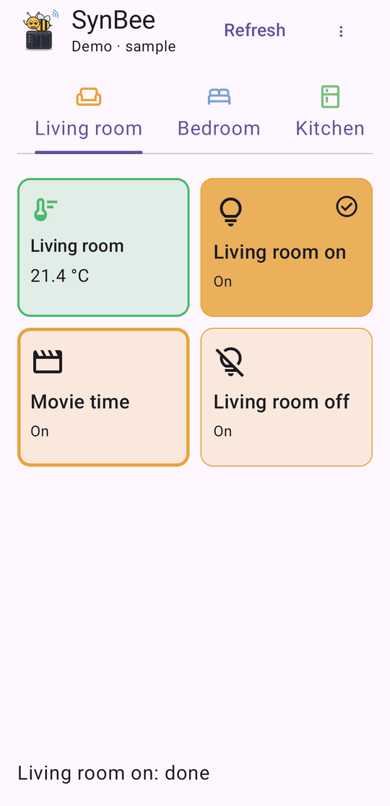
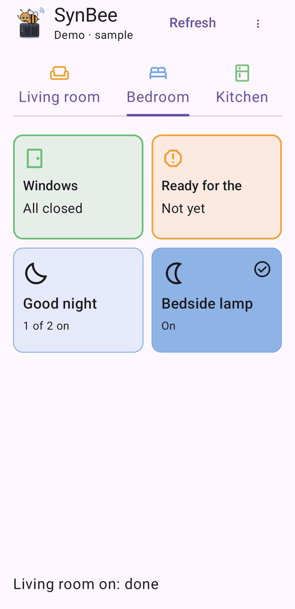
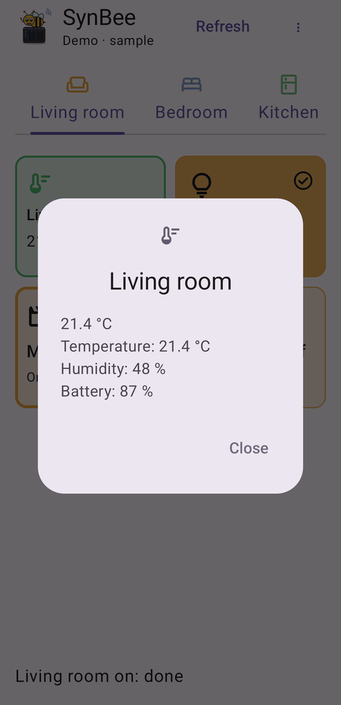
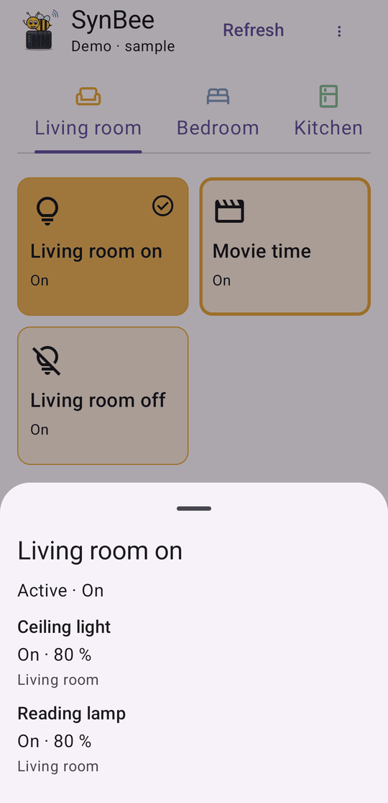
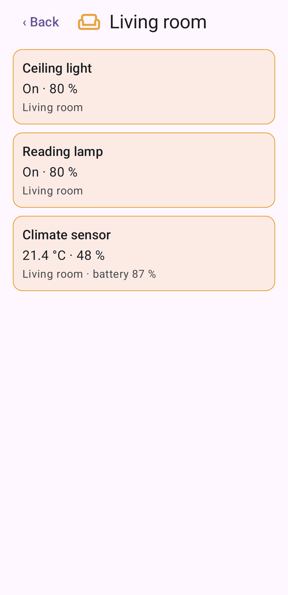
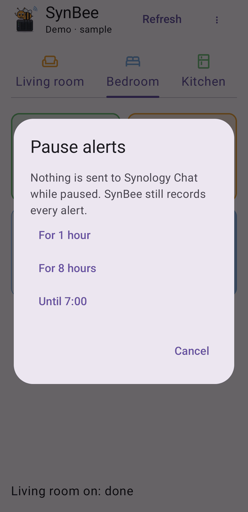
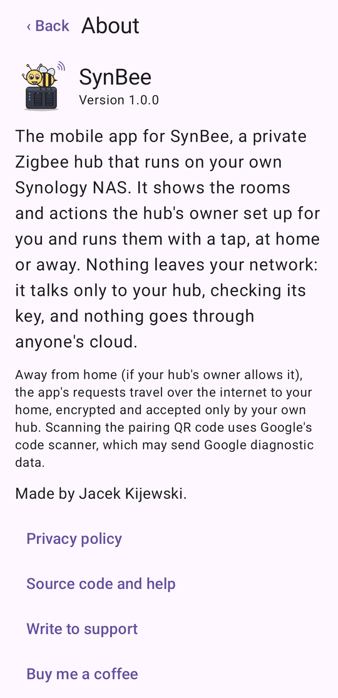

# SynBee app: user guide

The SynBee app is the remote control for a home run by **SynBee**, a smart home hub on a Synology NAS. With it you switch the lights and scenes of your home with one tap, and see what is on, at home and, if allowed, away.

> The pictures in this guide come from the app's demo, with a sample home.

**Contents**

1. [Before you start](#1-before-you-start)
2. [Pair your phone](#2-pair-your-phone)
3. [Your home screen](#3-your-home-screen)
4. [Status tiles: how things are](#4-status-tiles-how-things-are)
5. [Run an action](#5-run-an-action)
6. [See what an action switches](#6-see-what-an-action-switches)
7. [See a room's devices](#7-see-a-rooms-devices)
8. [Away from home](#8-away-from-home)
9. [Pause alerts](#9-pause-alerts)
10. [Try the demo](#10-try-the-demo)
11. [Privacy](#11-privacy)
12. [Questions and problems](#12-questions-and-problems)

## 1. Before you start

- **Your home needs SynBee.** The person who set up SynBee ("the owner") adds you as an app user in SynBee's web interface. You need nothing else: no account, no password, no email.
- **An Android phone** with Android 10 or newer.
- Install **SynBee** from Google Play.

The app can't change how your home is set up: which devices exist, what the actions do and what you may use are decided by the owner in SynBee.

## 2. Pair your phone

Pairing connects your phone to your home's SynBee, once.

1. Ask the owner to open **App users** in SynBee and press **Pair a phone** next to your name. A QR code appears on their screen.
2. Open the SynBee app and tap **Scan the QR code**. Point the camera at the QR code.
3. Your rooms appear. Done.

**No camera, or the QR code is on another phone?** Under **Or type it**, type the hub's address and the pairing code shown under the QR code, and tap **Continue**. The app then shows a key of four groups of characters: check it is the same as the one on the owner's screen, and tap **Same key, pair**. This check makes sure your phone talks to your own SynBee and nothing else.

A pairing code works once, for 10 minutes. You can pair at home or away from home.

## 3. Your home screen

- **Tabs** at the top are your rooms, with their icons and colours. **Swipe left or right** to move between rooms, or tap a tab.
- **Status tiles** come first: how things are in the room (see the next section).
- **Action tiles** are your actions, such as "Movie time" or "Good night".
- **The colour of a tile** tells you what the action switches:
  - filled with the room's colour: what it switches is **on**;
  - grey: it is **off**;
  - a thick border: only **some** of it is on.
- **A check mark** on a tile means everything already looks the way this action sets it.
- **The line under the name** says how things are now, for example "Off" or "2 of 3 on".
- The header shows your name, your phone, and whether you are connected **at home** or **away**. The app refreshes every few seconds while it is open; **Refresh** does it at once.

## 4. Status tiles: how things are

Status tiles show the state of things the owner chose: a temperature, a door, "all windows closed", "Ready for the night". They only show; they don't switch anything.

- **The colour** says how it is: green fine, grey for information, orange needs a look, red an alarm. Temperatures go from blue (cold) through green to red (hot).
- **Tap a status tile** to see why it shows what it shows, for example which window is open.

The owner decides which tiles you see; you may see different tiles than others in your home.

## 5. Run an action

**Tap a tile.** The action runs, and the tile changes to show the new state. If a device doesn't answer, the app tells you which action failed and why.

Some actions run only when something is true, such as "Away mode" only when everything is closed. If it isn't, nothing runs, and the app says why, for example "Away mode: not run, "Ready to leave" isn't true".

## 6. See what an action switches

**Long-press a tile.** A sheet opens with each device and light group the action switches, and how each is now: on or off, brightness, colour, and its battery and readings.

## 7. See a room's devices

**Long-press a room's tab.** The room's page lists its lights, switches and sensors, with their state: on or off, temperature, an open window, a leak, a low battery, and when each was last heard from.

## 8. Away from home

At home, the app talks to SynBee over your Wi-Fi. Away from home, it works only if the owner has switched on **Using the app away from home** in SynBee and allowed your phone. The app learns the address by itself.

Open **⋮ → Connection** to see which addresses the app uses, and whether your phone is allowed away from home. If the owner gave you an address and port to type, enter them there.

On Wi-Fi the app tries your home address first; elsewhere, the outside address first. It always checks it is talking to your own SynBee.

## 9. Pause alerts

If the owner set up alerts to Synology Chat and allowed you to, you can pause them, for example on a quiet evening. Open **⋮ → Pause alerts…** and choose **For 1 hour**, **For 8 hours** or **Until 7:00**. While paused, nothing is sent to Chat, and the bottom of the screen says until when. **⋮ → Resume alerts** turns them on again.

## 10. Try the demo

No SynBee yet, or want to show someone the app without your home? Tap **Try the demo** on the pairing screen, or **⋮ → Try the demo** once paired. The app shows a sample home with rooms and actions that you can tap and long-press, exactly as with a real home. Nothing is sent anywhere. Leave it with **⋮ → Leave the demo**; your own pairing is untouched.

## 11. Privacy

**Nothing leaves your network.**¹ The app talks only to your home's SynBee. There is no account, no cloud, no analytics and no ads. On your phone, the app keeps only your home's address, its key and an encrypted token, which never goes into backups. Read the full [privacy policy](../PRIVACY.md).

¹ Away from home (if allowed), the app's requests travel over the internet to your home, encrypted and accepted only by your own SynBee. Scanning the QR code uses Google's code scanner, which may send Google diagnostic data.

## 12. Questions and problems

**"The hub can't be reached".** At home, check that your phone is on your home Wi-Fi. Away, check with the owner that "Using the app away from home" is on and your phone is allowed.

**"Pair this phone again".** The owner revoked this phone, or removed you as a user. Ask for a new pairing code.

**"Not run".** The action runs only when something is true, and it wasn't; the message says what. Fix it (close the window) and tap again.

**An action is missing.** The owner decides which rooms and actions you may use. Ask them.

**A new phone?** Pair it the same way. Ask the owner to revoke the old one.

**Leave this home.** **⋮ → Forget hub** removes everything the app stored. Ask the owner to revoke the phone too.

**About the app.** **⋮ → About** shows the version, the licence and these links:

**Something else?** Write to jacek.kijewski.gdynia@gmail.com, or report it at [github.com/jkijewski/synbee-android/issues](https://github.com/jkijewski/synbee-android/issues). If you like SynBee, you can [buy me a coffee](https://buycoffee.to/jacek-kijewski).
